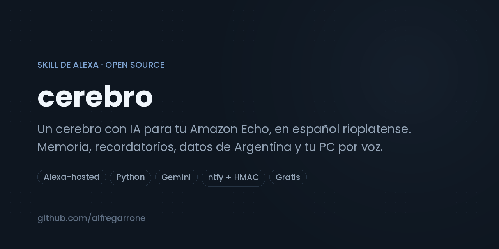

# Cerebro

> Un cerebro con IA para tu Amazon Echo, en español rioplatense. Conversación con memoria, recordatorios y temporizadores de Alexa, datos de Argentina en vivo (dólar, clima, fútbol, feriados, inflación) y un puente firmado con tu PC para notas, WhatsApp, luces, agenda, mails, avisos por Telegram y tareas con Claude Code. Gratis: corre en Alexa-hosted y usa el nivel gratuito de Gemini.

[](https://github.com/alfregarrone/cerebro/actions)
[](LICENSE)
[](docs/INSTALACION.md)

```
Vos:    Alexa, abrí cerebro
Alexa:  Hola. ¿En qué te ayudo?
Vos:    ¿a cuánto está el dólar blue y qué tiempo hace mañana?
Alexa:  El blue está a mil cuatrocientos ochenta. Mañana en Buenos Aires, parcialmente
        nublado, máxima de veintidós.
Vos:    recordame los lunes a las ocho que saque la basura
Alexa:  Listo, todos los lunes a las ocho.
Vos:    anotá en la compu: llamar a Marta por el presupuesto
Alexa:  Anotado.
```

## Qué es

Alexa sola contesta lo que Amazon decidió que conteste. Cerebro la conecta a un modelo de lenguaje
y le da tres cosas que no tiene: **memoria** de lo que le contás, **acciones** (recordatorios,
temporizadores, radio, datos en vivo) y **manos** en tu computadora.

Está pensado para Argentina: entiende voseo y expresiones locales, sabe qué es el blue y el riesgo
país, conoce los feriados y los equipos de la Liga Profesional. Y está pensado para que funcione
**sin pagar nada**: skill alojada por Amazon, Gemini en su nivel gratuito, y todos los datos en
vivo de APIs públicas sin clave.

## Qué puede hacer

| | Ejemplos de lo que le decís |
|---|---|
| **Conversar con memoria** | "mi vieja se llama Marta", "¿cómo se llama mi vieja?", "olvidate de eso" |
| **Recordatorios y alarmas** | "recordame en veinte minutos sacar la pizza", "despertame a las siete", "todos los lunes a las ocho, la basura", "¿qué recordatorios tengo?" |
| **Temporizadores** | "poné diez minutos para los fideos", "¿cuánto falta?", "cancelá el temporizador" |
| **Argentina en vivo** | "¿a cuánto está el dólar?", "¿cuándo es el próximo feriado?", "¿cómo va el riesgo país?", "¿cuánto fue la inflación?", "¿cuántos pesos son cien dólares?" |
| **Clima y noticias** | "¿qué tiempo hace?", "¿llueve el finde?", "¿qué pasó hoy?", "noticias de tecnología" |
| **Fútbol** | "¿cómo salió Boca?", "¿cuándo juega River?", "partidos de la fecha" |
| **Radio en el Echo** | "poné Mitre", "poné Rock and Pop", "pausá" |
| **Resumen del día** | "buenos días" → hora, clima, dólar, agenda, pendientes y feriado cercano en una sola frase |
| **Mandarte cosas al celular** | "pasame la receta al celular", "mandame esa lista" |
| **Tu PC** *(con el agente instalado)* | "anotá que...", "¿qué tengo pendiente?", "abrí YouTube", "poné música de Soda Stereo", "apagá la compu", "mandale un WhatsApp a Juan que llego tarde", "¿qué tengo mañana?", "¿tengo mails?", "prendé la luz del living", "sacá una captura", "pedile a Claude que ordene mi carpeta de descargas", "fijate en Instagram si tengo mensajes" |
| **Desde Telegram** *(con el agente)* | Lo mismo por escrito o nota de voz cuando no estás cerca del Echo, más el resumen de la mañana, avisos solos de dólar, lluvia, mails importantes y agenda, y los archivos que Claude genera |
| **Panel en la PC** *(con el agente)* | Una página local con todas las acciones de la PC para ejecutarlas y dejarlas automatizadas: rutinas por horario, avisos, alertas y el resumen de la mañana. Se abre con `abrir-panel.bat`, escribiendo "panel" al bot, o desde tu otra PC o el celular en la misma red |

## Cómo funciona

```
Echo ──► Alexa ──► Skill (Python, Alexa-hosted Lambda)
                       │
                       ├─ Vía rápida ── regex, sin IA: temporizadores, alarmas, dólar, clima…  (~1 s)
                       │
                       ├─ Gemini (varios modelos a la vez, gana el primero)  ──► respuesta + ACCIONES: [...]
                       │       ▲
                       │       └─ memoria: datos fijos + últimos mensajes (DynamoDB)
                       │
                       ├─ Acciones de Alexa: recordatorios, temporizadores, AudioPlayer
                       ├─ Datos en vivo: Open-Meteo, DolarApi, ArgentinaDatos, ESPN, Google News, CoinGecko…
                       │
                       └─ Puente con la PC ── ntfy.sh, mensajes firmados con HMAC ──► pc/cerebro_pc.py
                                                                                       │
                       Telegram (bot propio) ◄──── avisos, resumen de la mañana, órdenes ──┤
                       Panel web (navegador) ◄──── todas las acciones y automatizaciones ──┤
                                                                                       │
                          notas · apps · música · WhatsApp · luces · agenda · mails ◄──┤
                          capturas · tareas de pantalla y de código con Claude Code ◄──┘
```

Tres decisiones explican casi todo el diseño:

**Alexa corta a los ocho segundos.** Todo el presupuesto de tiempo está calculado alrededor de
eso: se consultan varios modelos de Gemini en paralelo y se usa el primero que responde; los
pedidos frecuentes (timers, alarmas, dólar, clima, fútbol) tienen una **vía rápida** por regex que
ni siquiera llama a la IA; y si algo tarda, el bot dice "un segundo" antes que quedarse callado.

**El modelo no ejecuta nada, propone.** Gemini responde texto y, si corresponde, una última línea
`ACCIONES: [...]` con JSON. El código valida y ejecuta cada acción con su propia lógica. Así, un
modelo que alucina una acción inexistente no rompe nada, y las cosas peligrosas (apagar la PC,
mandar un WhatsApp) piden confirmación por voz.

**La PC no expone ningún puerto.** El puente usa [ntfy.sh](https://ntfy.sh) como canal de
mensajes: la skill publica una orden firmada con HMAC-SHA256 en un tópico privado y espera la
respuesta, también firmada, en otro. La PC solo hace conexiones salientes, no hay que abrir el
router ni tener IP fija, y un mensaje sin firma válida se ignora. Si la PC está apagada, las notas
quedan en cola y se procesan al encenderse.

## Instalar

La guía completa está en **[docs/INSTALACION.md](docs/INSTALACION.md)**. En resumen:

1. Creá una skill Alexa-hosted (Python) en la [consola de Alexa](https://developer.amazon.com/alexa/console/ask).
2. Pegá el modelo de interacción de `skill-package/`, y el código de `lambda/`.
3. Copiá `lambda/config.example.py` a `lambda/config.py` y poné tu clave gratuita de Gemini.
4. Deploy. Decile "Alexa, abrí cerebro".
5. *(Opcional)* Copiá la carpeta `pc/` a tu computadora (Windows), completá `config_pc.json` y
   ejecutá `instalar.bat`. Con un bot de Telegram, además, te avisa al celular y le podés escribir.

Cómo hablarle, con todos los ejemplos: **[docs/USO.md](docs/USO.md)**. El panel de la PC, con el catálogo
completo y las automatizaciones: **[docs/PANEL.md](docs/PANEL.md)**.

## Estructura

```
lambda/                 código de la skill (Alexa-hosted, Python 3)
  lambda_function.py    handlers, acciones, vía rápida, puente con la PC
  config.example.py     plantilla de configuración (clave de Gemini, ciudad, zona horaria)
  requirements.txt
skill-package/          manifiesto y modelo de interacción (es-US)
pc/                     agente que corre en tu computadora (Windows)
  cerebro_pc.py         escucha ntfy.sh y Telegram, valida la firma y ejecuta la lista cerrada de acciones
  panel.py · panel.html panel web local: todas las acciones y las automatizaciones desde el navegador
  agenda.py · correo.py · casa.py · medios.py · whatsapp_app.py · escritorio.py · info.py
  instalar.bat · instalar-extras.bat · configurar.bat · abrir-panel.bat · ACTUALIZAR.bat · desinstalar.bat
  config.example.json   plantilla (enlace, Telegram, Gemini, calendario, Gmail, luces)
tests/                  suite automática (pytest): corre en CI sin red, sin AWS ni Windows; Echo falso y agente simulado
pruebas/                baterías manuales con la IA real y Windows: skill entera, bot de Telegram, agenda, mails, música
  panel.py · panel.html · panel_escritorio.py   panel web del agente y la ventana para la otra PC
docs/                   instalación, uso y panel
```

## Decisiones y limitaciones

- **Gemini gratuito, no OpenAI ni Claude.** El nivel gratuito de Google alcanza para uso personal
  y no pide tarjeta. La contra: la cuota diaria es limitada y la latencia varía mucho según la
  hora, por eso se consultan varios modelos a la vez y se marca como "agotado" el que devuelve 429.
- **Memoria en DynamoDB, la que regala Alexa-hosted.** Sin cuenta de AWS aparte ni costo. Se
  guardan hasta 60 datos fijos y los últimos 10 mensajes entre conversaciones.
- **Locale `es-US`.** Es el español que Alexa ofrece para skills en Latinoamérica. La persona del
  modelo está instruida para entender voseo; la voz de salida es la de Alexa.
- **La búsqueda web está apagada** porque el grounding de Gemini no está disponible en el nivel
  gratuito. Los datos en vivo salen de APIs públicas específicas, que son más rápidas y confiables
  que una búsqueda genérica para lo que este bot necesita.
- **El agente de PC no expone nada a internet y no hace nada que no esté en una lista.** Escucha
  ntfy.sh y Telegram con conexiones salientes, ejecuta solo las acciones de `ACCIONES`, y lo delicado
  (WhatsApp, apagar, ejecutar un plan de Claude Code) pide "sí". Claude Code corre con
  herramientas de solo lectura para consultar; para cambiar cosas, el plan pasa por tu celular.
  El único puerto es el del [panel web](docs/PANEL.md), que escucha solo en `127.0.0.1` (o en tu
  red de casa si lo pedís), con token y confirmación para lo peligroso.
- **Limitaciones actuales:** un solo usuario por skill (la memoria no distingue voces), la
  vía rápida está pensada en castellano rioplatense y no reconoce todas las variantes, las radios
  dependen del directorio público Radio Browser, y el agente de PC está hecho para Windows.

## Contribuir

Abrí un issue con el caso real antes de mandar código. [CONTRIBUTING.md](CONTRIBUTING.md) tiene el
flujo. Especialmente bienvenidos: más vías rápidas, más fuentes de datos argentinas sin clave, y
soporte del agente para Linux y macOS.

## Licencia

MIT © [Alfredo Garrone](https://github.com/alfregarrone) — construido en [CORX](https://corxargentina.com).
